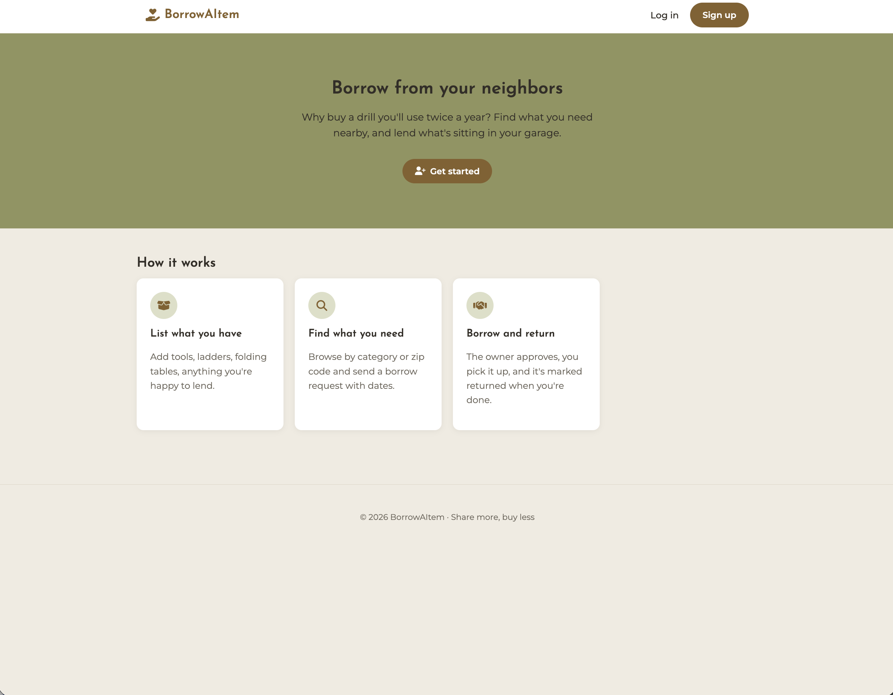

# 🤝 BorrowAItem

**A neighborhood lending library.** Borrow what you need from neighbors instead of buying something you'll use twice a year, and lend out what's sitting in your garage.

### 🔗 [Open the live app on Render](https://borrowaitem.onrender.com/)

---

## The Problem

People buy a drill, ladder, or folding table they'll use twice a year, while their neighbor has one sitting in the garage. Borrowing saves money and cuts waste, but there's no simple way to see what's available nearby or keep track of who has what.

## The Solution

BorrowAItem lets neighbors list items they're willing to lend, browse what's available by category, zip code, or name, and send borrow requests with dates. Owners approve or decline, items show as **Borrowed** until they're marked returned, and a simple thumbs-up rating builds trust over time.

---

## 📸 Screenshots

| Project Image |
| ------------- |



---

## ✨ Features

- **Authentication**: sign up, log in, and log out with sessions (Passport.js + bcrypt-hashed passwords)
- **List items**: add, edit, and remove items with a name, category, condition, and zip code
- **Browse & filter**: search by name, filter by category or zip code, and show only available items
- **Borrow requests**: request an item for specific dates, with validation that blocks past dates and invalid ranges
- **Approve / decline**: owners manage incoming requests; approving one auto-declines other pending requests for the same item
- **Return tracking**: items show as **Borrowed** until the owner marks them returned
- **My Items & My Borrows**: dashboards for everything you lend and everything you borrow
- **Overdue flag**: items still out past their end date are flagged for both owner and borrower
- **Trust ratings**: owners give borrowers a 👍 or 👎 after a return, and that track record shows on future requests
- **Request notifications**: a badge in the nav shows how many requests are waiting for you

---

## 🛠️ Tech Stack

| Tools        |
| ------------ | ---------------------------------------------------------------------------------- |
| **Backend**  | Node.js, Express 5                                                                 |
| **Database** | MongoDB Atlas, Mongoose                                                            |
| **Auth**     | Passport.js (local strategy), express-session, connect-mongo, bcrypt               |
| **Views**    | EJS templates with partials                                                        |
| **Styling**  | Custom CSS (CSS variables), Google Fonts (Josefin Sans + Montserrat), Font Awesome |

---

## 🚀 Getting Started

### Prerequisites

- [Node.js](https://nodejs.org/) v20 or later
- A free [MongoDB Atlas](https://www.mongodb.com/atlas) cluster

### Installation

1. **Clone the repo**

```bash
   git clone https://github.com/kb122215/BorrowAItem.git
   cd BorrowAItem
```

2. **Install dependencies**

```bash
   npm install
```

3. **Create a `.env` file** in the project root:

```
   MONGODB_URI=your-mongodb-atlas-connection-string
   SESSION_SECRET=any-long-random-string
   PORT=3001
```

Generate a secure session secret with:

```bash
   node -e "console.log(require('crypto').randomBytes(32).toString('hex'))"
```

4. **Start the server**

```bash
   npm run dev
```

5. Open **http://localhost:3001**

---

## 💡 What I Learned

- Structuring an Express app with separate routes, models, middleware, and views
- Session-based authentication with Passport.js
- Modeling relationships in MongoDB and using `.populate()` and aggregation pipelines
- Using Mongoose virtuals for computed values like overdue status
- Handling HTML form limitations with method-override for PUT and DELETE
- Building reusable EJS partials and keeping a consistent design system with CSS variables

---

## 👩🏽‍💻 Created By

**Karimah**

- GitHub: [@kb122215](https://github.com/kb122215)
